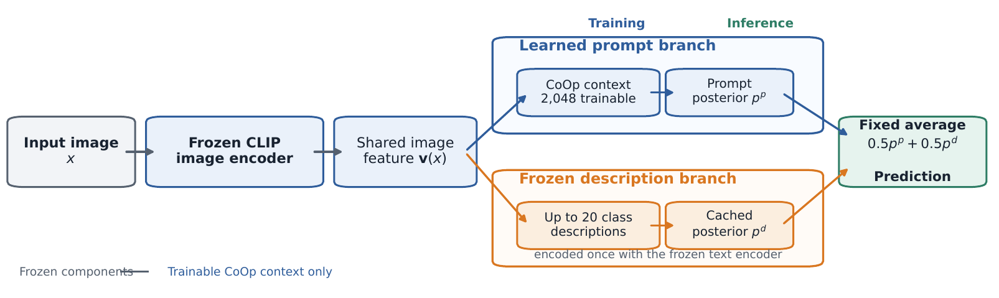
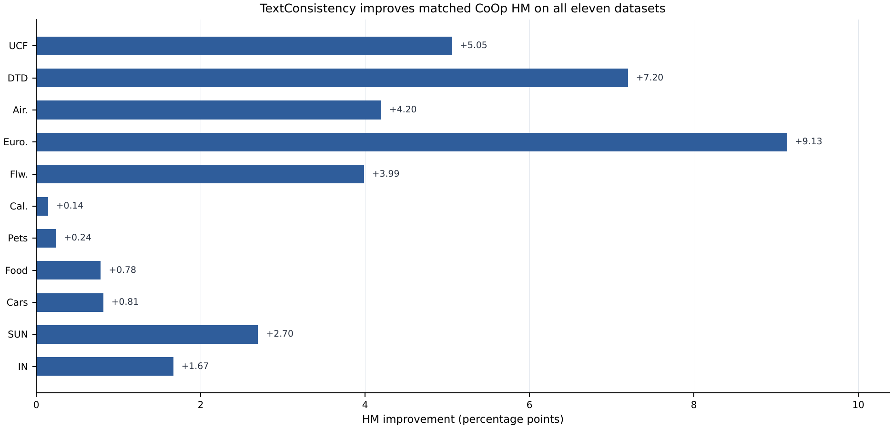
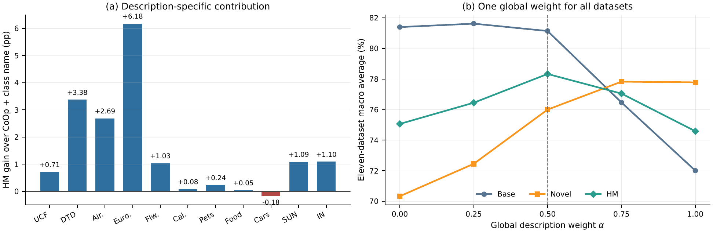
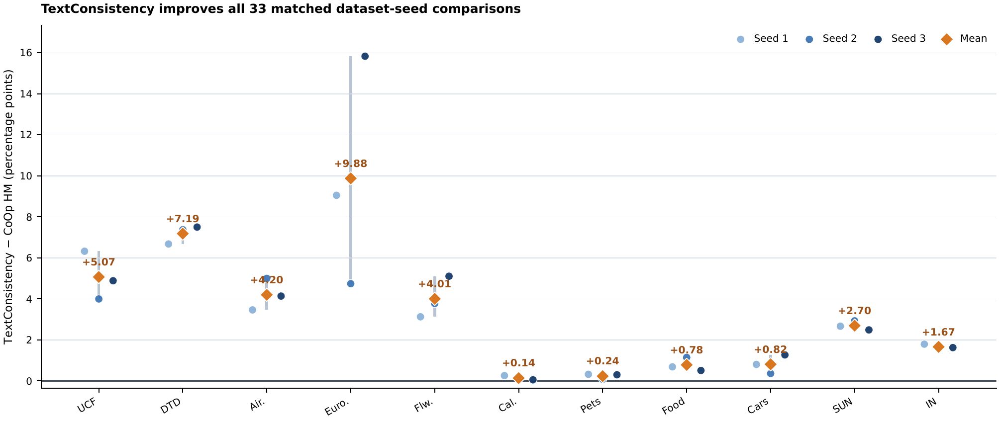

# TextConsistency：学习提示与类别描述的无参数概率融合，用于基础类别到新类别识别

> 中文阅读版，用于作者自查与导师审阅；正式投稿以英文版为准。作者、导师、学校与邮箱信息待按英文投稿版填写。

## 摘要

提示学习可以高效地把视觉语言模型适配到下游识别任务，但仅在基础类别上训练的提示可能丢失冻结模型原有的部分语义覆盖。本文研究一种无需增加可训练参数的恢复方法。TextConsistency 将 CoOp 学习提示产生的后验概率，与冻结的类别特定自然语言描述产生的第二个后验概率结合。每个类别内的描述嵌入先取平均，两条分支共享冻结的 CLIP 图像编码器，再以固定权重 0.5 融合类别概率。描述分支提前计算，不改变提示训练过程。

我们在标准 16-shot 基础类别到新类别协议下，使用 CLIP ViT-B/16、11 个数据集和 3 个随机种子进行评估。TextConsistency 的平均调和均值为 78.33，而匹配 CoOp 实验为 75.06，并在 33 个种子级配对比较中全部取得正增益。ImageNet 上，新类别准确率由 68.72 提高到 71.62，HM 由 72.39 提高到 74.05。11 数据集的类别名称对照达到 76.84 HM，说明收益不能用 CoOp 与普通零样本分类器的平均完全解释。在 RTX 4090 上，融合预测器不增加可训练参数，批大小 64 时推理延迟仅增加 0.74%。

**关键词：** 视觉语言模型；提示学习；少样本分类；基础类别到新类别泛化；类别描述；概率融合

## 1 引言

CLIP、ALIGN 等大规模视觉语言模型从海量图文数据中学习共享表示，并能通过文本提示完成开放词汇识别[1,10]。LiT 进一步表明，在保持图像编码器锁定的情况下调整文本塔，仍可保留很强的零样本迁移能力[11]。CoOp 用连续可学习向量替代人工上下文词，在少样本识别中获得显著提升[2]；但对已见基础类别的适配，有时会削弱对未见新类别的迁移。CoCoOp 通过图像条件提示缓解这一问题[3]，后续方法则引入提示分布、视觉—文本耦合提示、知识引导、自正则化或残差分类器[5–8,12]。

学习提示与描述性语言提供互补信息。学习上下文适配基础样本，自然语言描述保留属性、部件、场景与功能语义。本文发现：冻结描述分支单独使用时平均性能并未超过 CoOp，但二者后验结合后能够改善基础/新类别平衡，而且高于普通类别名称提示的同类融合。

TextConsistency 对每个类别编码一组固定描述，平均归一化嵌入形成类别原型；推理时平均 CoOp 后验与描述后验。所有划分、种子和数据集统一使用 0.5，不进行验证集或数据集特定调参。描述嵌入可以缓存，因此不增加可训练参数，只增加一次矩阵乘法、softmax 和概率平均。

本文贡献包括：

- 提出学习提示后验与冻结类别描述后验的固定概率融合，无需增加 CoOp 之外的可训练参数。
- 通过组件与类别名称对照分离分支互补和普通类别名称集成；描述融合比类别名融合高 1.49 HM。
- 在标准 11 个数据集、3 个种子上统一使用 0.5，达到 78.33 平均 HM，33/33 配对增益为正。
- 报告 RTX 4090 实测推理开销，并区分本地结果与论文引用值。

## 2 相关工作

### 2.1 视觉语言提示学习

CoOp、CoCoOp、ProDA、PLOT、ProGrad、LASP、MaPLe、KgCoOp、PromptSRC、TaskRes 与 PromptKD 分别从可学习上下文、条件提示、提示分布、最优传输、梯度约束、文本监督、多模态深层提示、知识约束、自正则化、残差分类器和蒸馏等角度改进提示适配[2,3,5–8,12–15,18]。近期 CasPL、TAC、DPC、CRAFT 与 ProText 继续引入级联结构、任务感知聚类、双提示协作、跨模态对齐与纯文本监督[26–30]。TPT 和 PromptAlign 则在测试时逐样本更新提示[16,17]。TextConsistency 保持 CoOp 训练和推理的确定性，只加入一个缓存文本分类器。

### 2.2 类别描述与免训练适配

CuPL、描述式分类、CHiLS、GPT-4 描述分类器和 Descriptor/Word Soups 研究了丰富语言语义对零样本或少样本识别的作用[4,21,22,24,25]。WaffleCLIP 表明随机词也可能贡献部分集成收益[23]，因此本文必须加入类别名称融合对照。Tip-Adapter、SuS-X 与 CALIP 代表免训练适配路线[9,19,20]；TextConsistency 的冻结分支来自文本，并与标准 CoOp 互补。

## 3 方法

### 3.1 问题设定

类别集合划分为基础类别和新类别。每个基础类别使用 16 张有标签图像训练。报告基础准确率 A_b、新类别准确率 A_n 和调和平均：

`H = 2 A_b A_n / (A_b + A_n)`

图像归一化特征为 `v(x)=E_v(x)/‖E_v(x)‖₂`，视觉与文本编码器均保持冻结。

### 3.2 学习提示分支

CoOp 的类别文本表示为 `tᵖ_c=E_t([q₁,…,q_M,c])/‖E_t([q₁,…,q_M,c])‖₂`，对应 `zᵖ_c(x)=s·v(x)ᵀtᵖ_c`，再经 softmax 得到 `pᵖ_c(x)`。仅上下文向量通过基础类别交叉熵训练。

### 3.3 冻结描述分支

描述来自 ProText 官方仓库，除 EuroSAT 外可追溯到 CuPL。CuPL 使用 GPT-3 DaVinci-002、2–9 条数据集特定指令、每条 10 个生成、温度 0.99、50-token 上限和句号停止符。本文不再次调用语言模型。处理过程保持源顺序，删除空串、精确重复项和分词后重复项，每类最多取前 20 条；不按准确率筛选。

每条描述归一化后求均值并再次归一化：`ū_c=[(1/m_c)Σⱼu_c,j]/‖(1/m_c)Σⱼu_c,j‖₂`。类别原型提前缓存，描述分支没有可训练参数。

### 3.4 固定概率融合

`pᵗᶜ_c(x)=(1−α)pᵖ_c(x)+αpᵈ_c(x)，α=0.5`。全部实验共用这一固定全局系数。

### 3.5 参数与计算成本

相较 CoOp，TextConsistency 增加 0 个可训练参数。ViT-B/16 的 CoOp 训练 2,048 个上下文参数；UCF101 测量中缓存描述张量占 0.0977 MiB。

## 4 实验设置

实验覆盖 ImageNet、Caltech101、OxfordPets、StanfordCars、OxfordFlowers、Food101、FGVC Aircraft、SUN397、DTD、EuroSAT 和 UCF101。使用 16-shot、随机种子 1/2/3。先平均基础/新类别准确率，再计算数据集 HM；跨数据集使用等权宏平均。

本地实验均使用 OpenAI CLIP ViT-B/16。CoOp 使用 4 个上下文词、批大小 16、SGD 学习率 0.002、动量 0.9、余弦调度和 20 个 epoch。输入为 224×224。严格匹配基线是 CoOp；CuPL、CoCoOp、KgCoOp、MaPLe、PromptSRC 使用论文报告值并标记 †。

## 5 实验结果

### 5.1 本地基础到新类别比较

| 方法 | UCF | DTD | Aircraft | EuroSAT | Flowers | Caltech | Pets | Food | Cars | SUN | ImageNet | 平均 |
| --- | --- | --- | --- | --- | --- | --- | --- | --- | --- | --- | --- | --- |
| CoOp | 74.42 | 63.79 | 34.26 | 67.52 | 81.07 | 95.95 | 96.39 | 90.51 | 72.35 | 77.05 | 72.39 | 75.06 |
| TextConsistency | 79.47 | 70.99 | 38.46 | 76.65 | 85.06 | 96.09 | 96.63 | 91.30 | 73.16 | 79.74 | 74.05 | 78.33 |

| 方法 | 基础类别 | 新类别 | 调和平均 HM |
| --- | --- | --- | --- |
| CoOp | 81.39 | 70.34 | 75.06 |
| TextConsistency | 81.13 | 76.00 | 78.33 |

TextConsistency 的 11 数据集平均 HM 为 78.33，相比 CoOp 的 75.06 提高 3.26 点。基础类别由 81.39 轻微变化为 81.13，新类别由 70.34 提高到 76.00；新类别 +5.66 是平衡改善的主要来源。11 个数据集、33 个种子配对全部为正增益。

### 5.2 与论文报告结果比较

| 方法 | UCF | DTD | Aircraft | EuroSAT | Flowers | Caltech | Pets | Food | Cars | SUN | 平均 |
| --- | --- | --- | --- | --- | --- | --- | --- | --- | --- | --- | --- |
| CuPL† | 76.40 | 61.30 | 33.20 | 61.80 | 76.10 | 95.60 | 95.80 | 90.60 | 68.80 | 75.70 | 73.53 |
| CoCoOp† | 77.64 | 64.85 | 27.74 | 71.21 | 81.71 | 95.84 | 96.43 | 90.99 | 72.01 | 78.27 | 75.67 |
| KgCoOp† | 79.65 | 64.35 | 34.83 | 73.48 | 83.65 | 96.03 | 96.18 | 91.09 | 73.36 | 78.36 | 77.10 |
| MaPLe† | 80.77 | 68.16 | 36.50 | 82.35 | 82.56 | 96.02 | 96.58 | 91.38 | 73.47 | 79.75 | 78.75 |
| PromptSRC† | 82.74 | 71.75 | 40.15 | 82.32 | 85.95 | 96.02 | 96.30 | 91.10 | 76.58 | 80.52 | 80.34 |
| TextConsistency | 79.47 | 70.99 | 38.46 | 76.65 | 85.06 | 96.09 | 96.63 | 91.30 | 73.16 | 79.74 | 78.75 |

十个共同数据集上，本文为 78.75，高于 CuPL、CoCoOp、KgCoOp，与 MaPLe 按表中精度持平，低于 PromptSRC 1.59 点。不同论文实现不完全一致，因此本表只用于定位。

### 5.3 组件分析

| 方法 | UCF | DTD | Aircraft | EuroSAT | Flowers | Caltech | Pets | Food | Cars | SUN | ImageNet | 平均 |
| --- | --- | --- | --- | --- | --- | --- | --- | --- | --- | --- | --- | --- |
| CoOp | 74.42 | 63.79 | 34.26 | 67.52 | 81.07 | 95.95 | 96.39 | 90.51 | 72.35 | 77.05 | 72.39 | 75.06 |
| 仅描述分支 | 76.46 | 63.30 | 34.83 | 69.99 | 76.69 | 96.29 | 95.27 | 90.58 | 67.53 | 76.73 | 72.77 | 74.59 |
| Logit 融合 | 78.76 | 70.75 | 38.31 | 75.69 | 83.73 | 96.09 | 96.64 | 91.30 | 72.86 | 79.54 | 74.01 | 77.97 |
| 概率融合（本文） | 79.47 | 70.99 | 38.46 | 76.65 | 85.06 | 96.09 | 96.63 | 91.30 | 73.16 | 79.74 | 74.05 | 78.33 |

描述分支单独为 74.59，低于 CoOp；logit 融合为 77.97，概率融合为 78.33，说明收益来自互补且概率融合更合适。

### 5.4 类别名称对照与全局权重

| 方法 | 基础类别 | 新类别 | HM |
| --- | --- | --- | --- |
| CoOp | 81.39 | 70.34 | 75.06 |
| 仅类别名 | 69.49 | 74.31 | 71.71 |
| CoOp + 类别名 | 80.71 | 73.80 | 76.84 |
| 仅类别描述 | 72.01 | 77.78 | 74.59 |
| TextConsistency | 81.13 | 76.00 | 78.33 |

CoOp+类别名为 76.84，TextConsistency 为 78.33，差 1.49 点；描述融合在 10/11 数据集、28/33 数据集—种子配对中更高。统一 α 网格中，0.5 得到最高 HM 78.33。

### 5.5 跨种子稳定性

全部 33 个配对 HM 差异为正。ImageNet 三个种子增益为 +1.80、+1.57、+1.63。图中菱形是种子级 HM 差值平均，可能与主表先平均基础/新类别准确率再计算 HM 的差值略有不同。

### 5.6 推理效率

| 方法 | 批大小 | 延迟（毫秒/批） | 吞吐（图/秒） | 相对开销 |
| --- | --- | --- | --- | --- |
| CoOp | 1 | 18.827 | 53.12 | 0.00% |
| TextConsistency | 1 | 18.904 | 52.90 | 0.41% |
| CoOp | 64 | 90.128 | 710.10 | 0.00% |
| TextConsistency | 64 | 90.796 | 704.88 | 0.74% |

批大小 64 时，延迟由 90.128 ms 增至 90.796 ms，开销 0.74%；没有新增可训练参数。

## 6 讨论与局限

证据支持固定概率融合能够恢复提示适配后未被充分利用的冻结语义：描述融合 HM 为 78.33，比 CoOp 高 3.26，也比同权重类别名融合高 1.49。局限包括：只使用公开 CuPL/ProText 描述；融合权重只做五点粗网格分析；效率只在一张 RTX 4090 上测量。

公开仓库保存固定数据划分、随机种子、配置、日志、源文件哈希、机器可读汇总与独立复算脚本。

## 7 结论

TextConsistency 以固定权重平均学习提示与冻结类别描述的后验，不改变 CoOp 训练，也不增加可训练参数。11 数据集平均 HM 从 75.06 提高到 78.33，33/33 配对均为正；语义对照与组件消融支持描述互补这一解释。

## 数据与代码可用性

仓库：[guiyangyuan/textconsistency_v2_tune](https://github.com/guiyangyuan/textconsistency_v2_tune)。

## 附录 A：逐数据集种子统计

| 数据集 | 方法 | 基础类别 | 新类别 | 种子级 HM | 种子1 | 种子2 | 种子3 |
| --- | --- | --- | --- | --- | --- | --- | --- |
| UCF101 | CoOp | 83.56±0.45 | 67.08±2.90 | 74.40±1.94 | 72.48 | 76.36 | 74.36 |
| UCF101 | TextConsistency | 82.70±0.43 | 76.49±1.13 | 79.47±0.80 | 78.81 | 80.36 | 79.24 |
| DTD | CoOp | 77.78±0.92 | 54.07±0.77 | 63.79±0.77 | 63.60 | 63.13 | 64.64 |
| DTD | TextConsistency | 77.93±0.48 | 65.18±1.82 | 70.98±1.02 | 70.28 | 70.51 | 72.14 |
| FGVC Aircraft | CoOp | 37.54±0.92 | 31.51±1.84 | 34.25±1.31 | 35.36 | 32.80 | 34.57 |
| FGVC Aircraft | TextConsistency | 37.47±0.09 | 39.49±1.27 | 38.45±0.56 | 38.83 | 37.80 | 38.72 |
| EuroSAT | CoOp | 84.38±4.27 | 56.28±13.40 | 66.64±8.04 | 65.77 | 75.08 | 59.07 |
| EuroSAT | TextConsistency | 84.56±1.65 | 70.10±6.04 | 76.52±2.87 | 74.82 | 79.83 | 74.91 |
| OxfordFlowers | CoOp | 97.02±0.43 | 69.62±3.03 | 81.04±1.97 | 82.57 | 81.74 | 78.82 |
| OxfordFlowers | TextConsistency | 95.73±0.41 | 76.52±1.72 | 85.05±0.98 | 85.70 | 85.52 | 83.92 |
| Caltech101 | CoOp | 98.02±0.36 | 93.96±1.26 | 95.94±0.52 | 96.53 | 95.74 | 95.56 |
| Caltech101 | TextConsistency | 98.00±0.13 | 94.25±1.30 | 96.08±0.63 | 96.79 | 95.85 | 95.61 |
| OxfordPets | CoOp | 95.57±0.26 | 97.22±0.48 | 96.39±0.26 | 96.28 | 96.69 | 96.19 |
| OxfordPets | TextConsistency | 95.61±0.20 | 97.67±0.36 | 96.63±0.14 | 96.61 | 96.77 | 96.50 |
| Food101 | CoOp | 90.10±0.23 | 90.94±0.75 | 90.51±0.46 | 90.68 | 90.00 | 90.87 |
| Food101 | TextConsistency | 90.65±0.16 | 91.95±0.16 | 91.30±0.13 | 91.37 | 91.15 | 91.38 |
| StanfordCars | CoOp | 74.33±0.98 | 70.47±1.17 | 72.34±0.45 | 71.97 | 72.85 | 72.20 |
| StanfordCars | TextConsistency | 72.11±1.14 | 74.25±0.72 | 73.16±0.35 | 72.78 | 73.21 | 73.47 |
| SUN397 | CoOp | 80.54±0.16 | 73.85±0.63 | 77.04±0.29 | 77.05 | 76.75 | 77.33 |
| SUN397 | TextConsistency | 81.07±0.15 | 78.46±0.15 | 79.74±0.07 | 79.72 | 79.68 | 79.82 |
| ImageNet | CoOp | 76.47±0.06 | 68.72±0.21 | 72.39±0.13 | 72.24 | 72.48 | 72.44 |
| ImageNet | TextConsistency | 76.66±0.07 | 71.62±0.08 | 74.05±0.02 | 74.04 | 74.05 | 74.07 |

## 参考文献

[1] A. Radford et al., Learning Transferable Visual Models From Natural Language Supervision, ICML, 2021, pp. 8748–8763.

[2] K. Zhou, J. Yang, C. C. Loy, Z. Liu, Learning to Prompt for Vision-Language Models, International Journal of Computer Vision 130 (2022) 2337–2348.

[3] K. Zhou, J. Yang, C. C. Loy, Z. Liu, Conditional Prompt Learning for Vision-Language Models, CVPR, 2022, pp. 16816–16825.

[4] S. Pratt, I. Covert, R. Liu, A. Farhadi, What Does a Platypus Look Like? Generating Customized Prompts for Zero-Shot Image Classification, ICCV, 2023, pp. 15691–15701.

[5] Y. Lu, J. Liu, Y. Zhang, Y. Liu, X. Tian, Prompt Distribution Learning, CVPR, 2022, pp. 5206–5215.

[6] M. U. Khattak et al., MaPLe: Multi-modal Prompt Learning, CVPR, 2023, pp. 19113–19122.

[7] H. Yao, R. Zhang, C. Xu, Visual-Language Prompt Tuning with Knowledge-Guided Context Optimization, CVPR, 2023, pp. 6757–6767.

[8] M. U. Khattak et al., Self-regulating Prompts: Foundational Model Adaptation without Forgetting, ICCV, 2023, pp. 15190–15200.

[9] R. Zhang et al., Tip-Adapter: Training-Free Adaption of CLIP for Few-Shot Classification, ECCV, 2022, pp. 493–510.

[10] C. Jia et al., Scaling Up Visual and Vision-Language Representation Learning With Noisy Text Supervision, ICML, 2021, pp. 4904–4916.

[11] X. Zhai et al., LiT: Zero-Shot Transfer With Locked-Image Text Tuning, CVPR, 2022, pp. 18123–18133.

[12] T. Yu et al., Task Residual for Tuning Vision-Language Models, CVPR, 2023, pp. 10899–10909.

[13] B. Zhu et al., Prompt-aligned Gradient for Prompt Tuning, ICCV, 2023, pp. 15659–15669.

[14] A. Bulat, G. Tzimiropoulos, LASP: Text-to-Text Optimization for Language-Aware Soft Prompting of Vision and Language Models, CVPR, 2023, pp. 23232–23241.

[15] G. Chen et al., PLOT: Prompt Learning with Optimal Transport for Vision-Language Models, ICLR, 2023.

[16] M. Shu et al., Test-Time Prompt Tuning for Zero-Shot Generalization in Vision-Language Models, NeurIPS 35, 2022.

[17] J. A. Samadh et al., Align Your Prompts: Test-Time Prompting with Distribution Alignment for Zero-Shot Generalization, NeurIPS 36, 2023.

[18] Z. Li et al., PromptKD: Unsupervised Prompt Distillation for Vision-Language Models, CVPR, 2024, pp. 26617–26626.

[19] V. Udandarao, A. Gupta, S. Albanie, SuS-X: Training-Free Name-Only Transfer of Vision-Language Models, ICCV, 2023, pp. 2725–2736.

[20] Z. Guo et al., CALIP: Zero-Shot Enhancement of CLIP with Parameter-Free Attention, AAAI 37(1) (2023) 746–754.

[21] S. Menon, C. Vondrick, Visual Classification via Description from Large Language Models, ICLR, 2023.

[22] Z. Novack et al., CHiLS: Zero-Shot Image Classification with Hierarchical Label Sets, ICML, 2023, pp. 26342–26362.

[23] K. Roth et al., Waffling Around for Performance: Visual Classification with Random Words and Broad Concepts, ICCV, 2023, pp. 15746–15757.

[24] C. Liao, T. Tsiligkaridis, B. Kulis, Descriptor and Word Soups: Overcoming the Parameter Efficiency Accuracy Tradeoff for Out-of-Distribution Few-Shot Learning, CVPR, 2024, pp. 27015–27025.

[25] M. Maniparambil et al., Enhancing CLIP with GPT-4: Harnessing Visual Descriptions as Prompts, ICCV Workshops, 2023, pp. 262–271.

[26] M. U. Khattak et al., Learning to Prompt with Text Only Supervision for Vision-Language Models, AAAI 39 (2025) 4230–4238.

[27] G. Wu et al., Cascade Prompt Learning for Vision-Language Model Adaptation, ECCV, 2024, pp. 304–321.

[28] F. Hao et al., Task-Aware Clustering for Prompting Vision-Language Models, CVPR, 2025, pp. 14745–14755.

[29] H. Li et al., DPC: Dual-Prompt Collaboration for Tuning Vision-Language Models, CVPR, 2025, pp. 25623–25632.

[30] J. Sun et al., Cross-Modal Feature Alignment and MMD Improve Robustness of Prompt Tuning, WACV, 2025, pp. 4714–4724.
